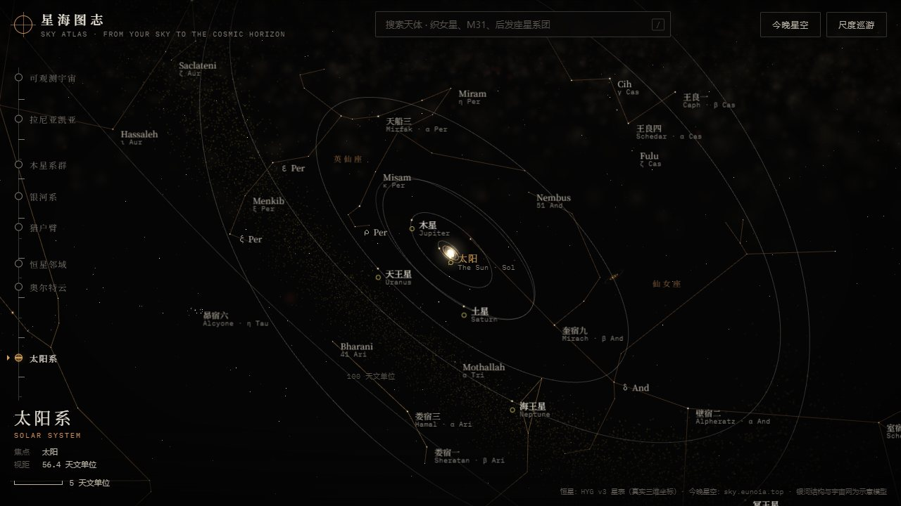
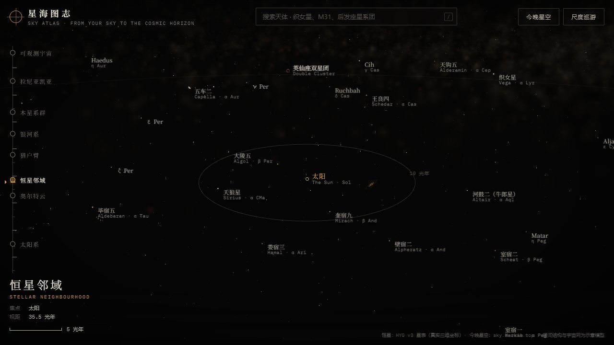
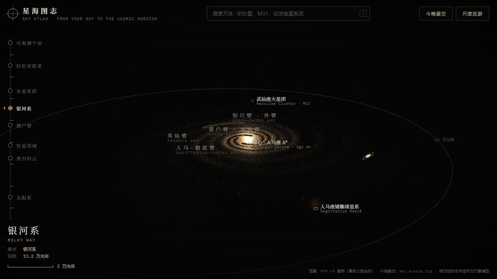
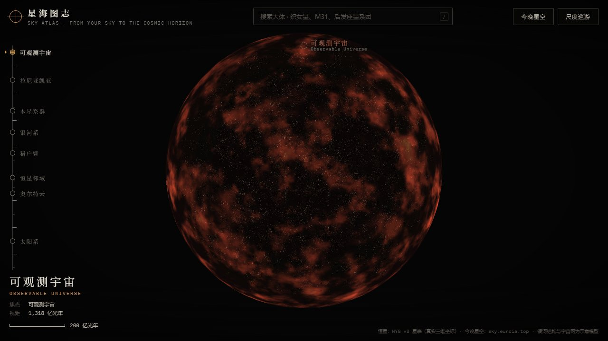
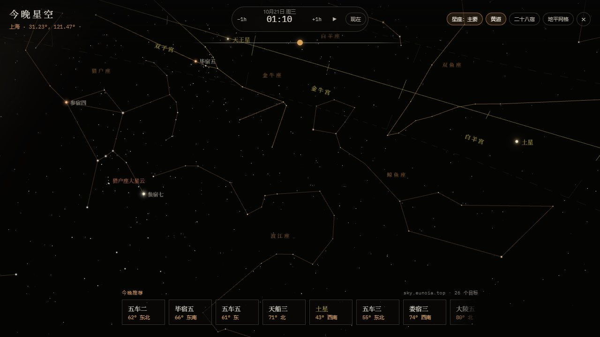
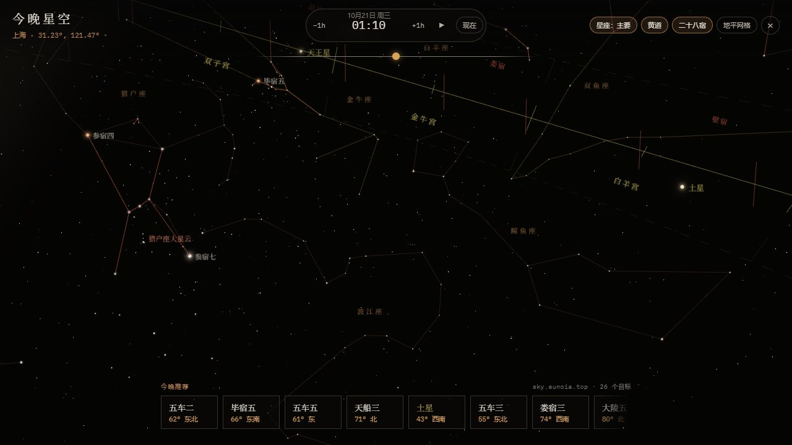
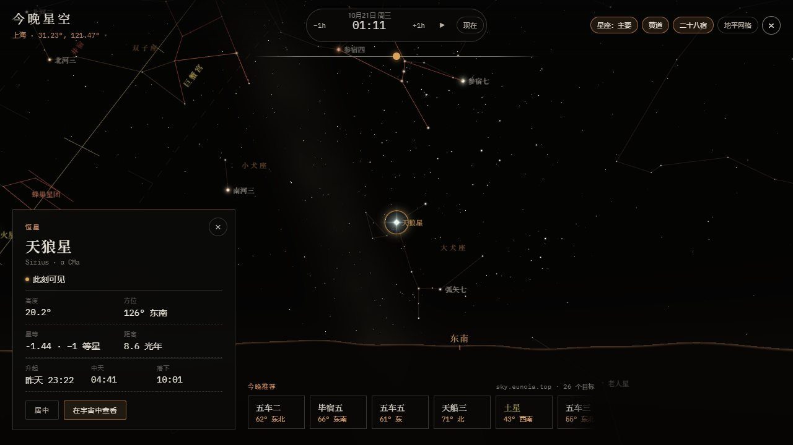

<div align="center">

# 星海图志 · Sky Monitor

**从你头顶的这片夜空出发，一直走到可观测宇宙的边界。**

一个位置感知的观星项目：FastAPI 星图后端计算“此时此地能看到什么”，<br>
three.js 前端把它画成一张跨越 16 个数量级的交互星图，以及一片真实的今晚星空。

[**在线体验 sky.eunoia.top**](https://sky.eunoia.top/) · [今晚星空](https://sky.eunoia.top/tonight) · [尺度巡游](https://sky.eunoia.top/tour) · [API 文档](https://sky.eunoia.top/docs) · [Wiki](https://sky.eunoia.top/wiki)


<sub>演示录屏（2 倍速）。高清版：<a href="docs/media/demo.mp4">docs/media/demo.mp4</a></sub>

</div>

## 效果展示

### 三维宇宙图谱

左侧的尺度阶梯可以一键飞往各个尺度，从太阳系、恒星邻域、银河系、本星系群，一直到可观测宇宙。恒星采用 HYG 星表中约 10.9 万颗星的真实三维位置，亮度按镜头所在位置实时计算。

| 太阳系 | 恒星邻域 |
|---|---|
|  |  |
| **银河系** | **可观测宇宙** |
|  |  |

### 今晚星空

仿照 Star Walk 的观测者视角，按你所在的位置和时间呈现真实天空。

| 黄道带与十二宫、节气 | 二十八宿 |
|---|---|
|  |  |



- **真实的星光**：
  - **大小和眩光**：按星等等级决定。零等星和负等星带光晕和十字芒。
  - **颜色**：按色指数着色。亮星颜色饱和，暗星偏灰白，和人眼看到的一致。
  - **闪烁**：每颗星有自己的节奏，越靠近地平线越强。低空的亮星会出现彩色闪烁，比如冬夜低空的天狼星。
  - **大气消光**：地平线附近的星光会变暗。
- **黄道**：
  - ±8° 的黄道带，配十二宫和二十四节气。
  - 太阳所在的宫和节气会高亮。
  - 太阳的信息卡给出黄经、当前节气和下一个节气的日期。
- **二十八宿**：
  - 朱砂色星官连线，宿界画在过距星的赤经圈上。
  - 显示四象名称：东方苍龙、北方玄武、西方白虎、南方朱雀。
  - 月亮的信息卡显示“月宿”，太阳的信息卡显示“日躔”。
- **交互**：
  - 拖拽环顾，滚轮或双指缩放。
  - 时间胶囊可以前后拨动，也可以加速播放。
  - 手机上可以开启陀螺仪，直接对准天空。
  - 信息卡给出高度、方位、升起/中天/落下时间，还可以一键跳回三维图谱。
- **今晚推荐**：直接来自本仓库的 `/sky/chart` 接口；后端不可达时自动改用本地计算。
- **中英双语**：默认英文，右上角一键切换中文（也可用 `?lang=zh` / `?lang=en`），选择会被记住。
- **服务目录**：首页“Services / 服务”菜单直达 Wiki、服务状态、API 手册、Swagger、ReDoc、OpenAPI 和健康检查。

## 架构

```text
                    https://sky.eunoia.top  (nginx，同域)
          ┌──────────────────────┴──────────────────────┐
  /, /tonight, /tour, /assets, /data         /sky/*, /docs, /wiki, /health ...
          │                                             │
   atlas/  (Vite + TypeScript + three.js)       app/  (FastAPI + Skyfield)
   三维宇宙图谱 · 今晚星空                         星表查询 · 星图投影 · 推理语料
          └──────────── POST /sky/chart ────────────────┘
```

| 目录 | 内容 |
|---|---|
| [`atlas/`](atlas/) | 前端星图，详见 [atlas/README.md](atlas/README.md) |
| `app/` | FastAPI 入口、天文计算、SQLite 星表查询、深空天体、推理语料 |
| `data/` | 可提交的中文观测语料 |
| `scripts/` | 下载 HYG 星表和 DE421 星历，构建 SQLite 星表和城市索引 |
| `site/wiki/` | 静态 Wiki（`/wiki`）、API 调用手册（`/wiki/api`）、服务监控台（`/wiki/health`，逐项检查接口、延迟趋势和可用率），共用 `wiki.css`，与星图同一套配色 |
| `deploy/` | systemd 和 nginx 示例（含前端路由） |
| `docs/media/` | README 用的截图和录屏 |
| `tests/` | 后端单元测试 |

## 快速开始

### 后端

推荐 Python 3.10 或更高版本。

```bash
python -m venv .venv
source .venv/bin/activate
pip install -r requirements.txt

python scripts/download_hyg.py        # HYG 恒星星表
python scripts/build_catalog_db.py    # 构建 SQLite 星表
python scripts/download_ephemeris.py  # JPL DE421 星历
python scripts/build_city_index.py    # Wiki 用的城市坐标索引（可选）

uvicorn app.main:app --host 0.0.0.0 --port 8000
```

启动后可以打开：<http://127.0.0.1:8000/health>、<http://127.0.0.1:8000/docs>、<http://127.0.0.1:8000/sky/chart?latitude=31.4591&longitude=121.1298&total_limit=8>

### 前端

```bash
cd atlas
npm install
npm run dev     # http://localhost:5173 ，/sky-api 代理到线上后端
npm run build   # 产物在 atlas/dist/
```

前端在 `atlas/public/data/` 中自带烘焙好的星表，可以直接运行。用 `npm run data` 可以从后端下载的 HYG CSV 重新生成。

## 后端 API

功能概览：

- 根据 GPS 坐标计算地平坐标系下的高度角和方位角。默认筛选高度角 ≥ 15°、亮度适合展示的目标。
- 恒星来自 HYG Database，行星位置用 Skyfield + JPL DE421 计算，另有常见 Messier/NGC 深空天体清单。
- `/sky/chart` 返回 `chart_x`、`chart_y`、`chart_radius`，前端可以直接绘制极坐标星图。可以用 `time_utc` 指定观测时间。
- `reasoning_context` 提供中文观测建议和目标解释，便于 LLM 工具调用。
- OpenAPI 的 `servers` 可以通过环境变量配置，适合接入灵珠等只接受 HTTPS 域名的工具平台。

### 健康检查

```bash
curl "https://sky.eunoia.top/health"
# {"status": "ok", "version": "0.3.1", "catalog_db_exists": true}
```

### 生成星图

```bash
curl "https://sky.eunoia.top/sky/chart?latitude=31.4591&longitude=121.1298&total_limit=8"

curl -X POST "https://sky.eunoia.top/sky/chart" \
  -H "Content-Type: application/json" \
  -d '{
    "latitude": 31.4591,
    "longitude": 121.1298,
    "min_altitude_deg": 15,
    "max_magnitude": 3,
    "deep_sky_max_mag": 9,
    "total_limit": 28
  }'
```

关键返回结构：

```json
{
  "sky_chart": {
    "observer": { "lat": 31.4591, "lon": 121.1298 },
    "time_utc": "2026-05-17T03:00:00Z",
    "coordinate_system": { "chart_projection": "polar_azimuthal_horizon" },
    "counts": { "star": 7, "planet": 1 },
    "objects": [
      {
        "category": "star",
        "display_name": "南河三",
        "azimuth_deg": 242.65,
        "altitude_deg": 44.83,
        "magnitude": 0.4,
        "chart_x": -0.4965,
        "chart_y": -0.2567,
        "chart_radius": 0.5019
      }
    ],
    "reasoning_context": {
      "corpus_version": "0.1.0",
      "summary": "当前位置纬度 31.4591、经度 121.1298，本次筛选得到 8 个适合星图展示的目标。",
      "bullets": [],
      "object_insights": []
    }
  }
}
```

### 其他接口

```bash
curl "https://sky.eunoia.top/reasoning/corpus"        # 生成 reasoning_context 用的中文观测语料
curl "https://sky.eunoia.top/catalog/stats"
curl "https://sky.eunoia.top/stars/bright?limit=20"
curl "https://sky.eunoia.top/stars/search?name=Sirius"
```

### 灵珠平台接入

推荐导入 OpenAPI：`https://sky.eunoia.top/openapi.json`。工具主动作建议选 `GET /sky/chart`，参数只需要传 `latitude` 和 `longitude`（Query，number），其他筛选参数用后端默认值。

### 环境变量

复制 `.env.example` 作为参考：

| 变量 | 默认值 | 说明 |
| --- | --- | --- |
| `SKY_CATALOG_DB` | `data/catalog.db` | SQLite 星表路径 |
| `SKY_PUBLIC_BASE_URL` | `https://sky.eunoia.top` | OpenAPI `servers[0].url` |

## 部署

```bash
# 后端：FastAPI 绑定 127.0.0.1:8000，由 systemd 托管
sudo cp deploy/lingzhuback.service /etc/systemd/system/lingzhuback.service
sudo systemctl daemon-reload
sudo systemctl enable --now lingzhuback

# 前端：构建后发布到 nginx 静态目录
cd atlas && npm run build
sudo mkdir -p /var/www/sky-atlas && sudo cp -r dist /var/www/sky-atlas/site

# nginx：星图为首页，其余路径反向代理到后端
sudo cp deploy/nginx.example.conf /etc/nginx/sites-available/sky-monitor-api
sudo ln -s /etc/nginx/sites-available/sky-monitor-api /etc/nginx/sites-enabled/sky-monitor-api
sudo nginx -t && sudo systemctl reload nginx
```

线上部署建议：

- 使用 HTTPS 域名访问，不要暴露“裸 IP + 端口”。
- 设置 `SKY_PUBLIC_BASE_URL` 为你的域名。
- 前后端同域部署时，前端直接请求 `/sky/chart`，不需要配置 CORS。

## 测试

```bash
pytest -q             # 后端：请求模型、星表构建与查询、推理语料
cd atlas && npm run build   # 前端：TypeScript 类型检查 + 构建
```

## 数据与许可证

代码采用 MIT License。第三方数据遵循各自的许可：

| 数据 | 许可 | 仓库中的形式 |
|---|---|---|
| HYG Database v3 | CC BY-SA 2.5 | 后端原始 CSV 不提交（脚本下载）；前端提交烘焙后的 `atlas/public/data/stars.bin`、`named.json` |
| JPL DE421 | 公有领域 | 不提交，脚本下载 |
| d3-celestial 星座 / 中国星官数据 | BSD-3-Clause | `atlas/public/data/constellations.json`、`mansions.json`，附 `CONSTELLATIONS-LICENSE.txt` |
| GeoNames cities1000 | CC BY 4.0 | 不提交，脚本生成 |
